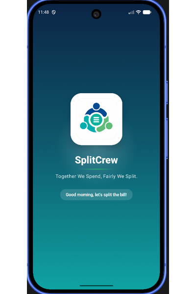
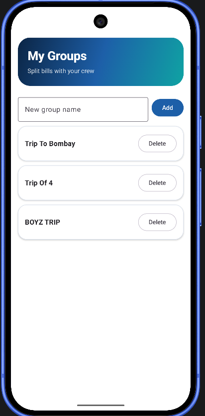
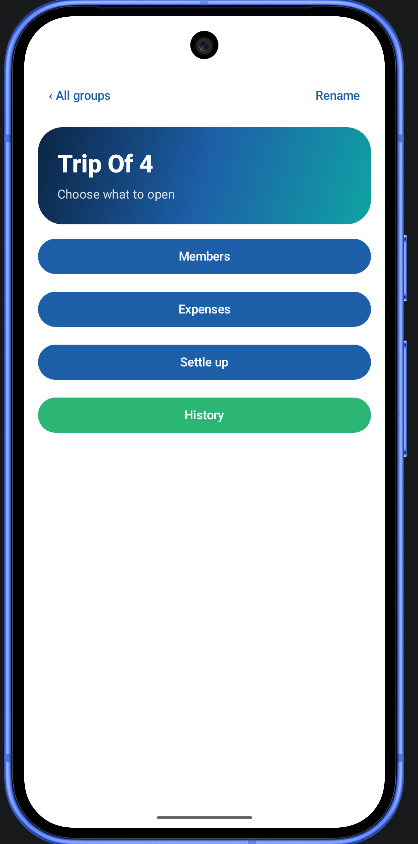
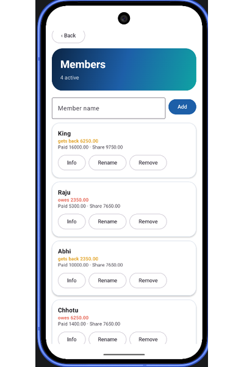
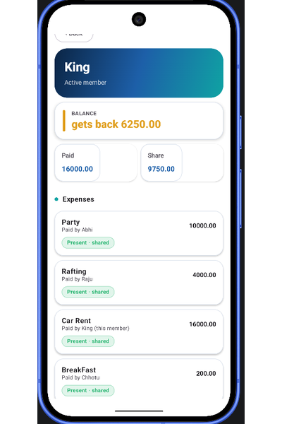
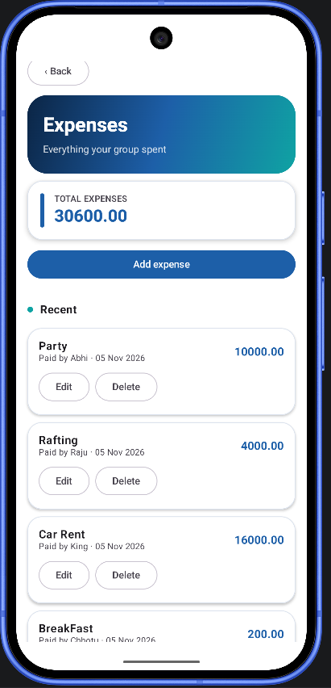
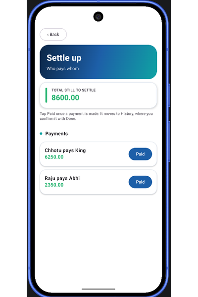
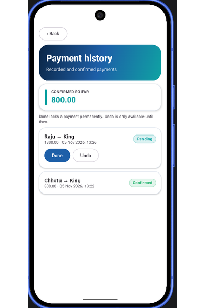
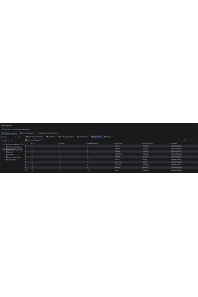

# SplitCrew

**Split bills fairly. Settle up simply.**

An Android expense splitter for friends, flatmates, and travel groups, built with Kotlin and Jetpack Compose.

---

## Overview

SplitCrew tracks shared expenses within a group and works out exactly who owes whom. Each expense is shared only among the members who were active when it was recorded, so removing or adding someone never rewrites past splits.

Balances are calculated in exact integer cents, leftover cents are distributed fairly, and the settle-up plan uses the fewest possible payments. Confirmed payments are locked in history, so they cannot be quietly changed.

## Screenshots

### Welcome and Groups

### Members and Expenses

### Settle Up and History

## Features

- **Groups:** create, rename, and delete groups
- **Members:** add, rename, remove, and restore members with their original balances
- **Expenses:** add, edit, and delete expenses with a payer and equal split
- **Balances:** exact cent-level accuracy with fair distribution of leftover cents
- **Settle up:** the fewest payments needed to clear every balance
- **History:** record payments as Paid, lock them with Done, or Undo while pending
- **Member info:** each member's expenses, presence, and remaining settlement
- **Experience:** light and dark themes, animated splash screen, rotation-safe navigation

## Architecture

SplitCrew follows MVVM with a clear separation of layers:

- **UI layer:** Jetpack Compose screens observe state from the ViewModel
- **ViewModel:** holds screen state and exposes data as `StateFlow`
- **Repository:** single access point to the database
- **Data layer:** Room entities, DAO, and database
- **Domain layer:** pure Kotlin balance and settlement logic, independent of Android

## Tech Stack

| Area | Technology |
|---|---|
| Language | Kotlin |
| UI | Jetpack Compose, Material 3 |
| Architecture | MVVM, Repository pattern |
| Persistence | Room (SQLite) |
| Async and state | Kotlin Coroutines, Flow, StateFlow |
| Testing | JUnit |

## Project Structure

- `app/src/main/java/com/dhirajmane/splitcrew/`
    - `MainActivity.kt`: entry point and screen navigation
    - `AppContainer.kt`: manual dependency setup
    - `data/`: Room entities, DAO, and repository
    - `domain/`: balance and settlement calculations
    - `ui/groups/`: Compose screens and ViewModel
    - `ui/theme/`: colors, typography, and shared components
- `app/src/test/`: unit tests for balance and settlement logic
- `Assets/Images/`: screenshots used in this README

## Getting Started

1. Clone the repository
2. Open the project in Android Studio (Ladybug or newer)
3. Run the app on an emulator or a device running Android 8.0 (API 26) or higher

## Author

**Dhiraj Mane**
GitHub: [@Dhiraj1574](https://github.com/Dhiraj1574)

---

If you found this project useful, consider giving it a star.

